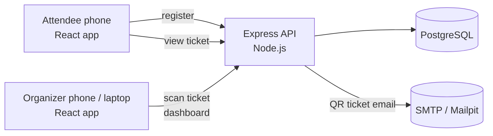
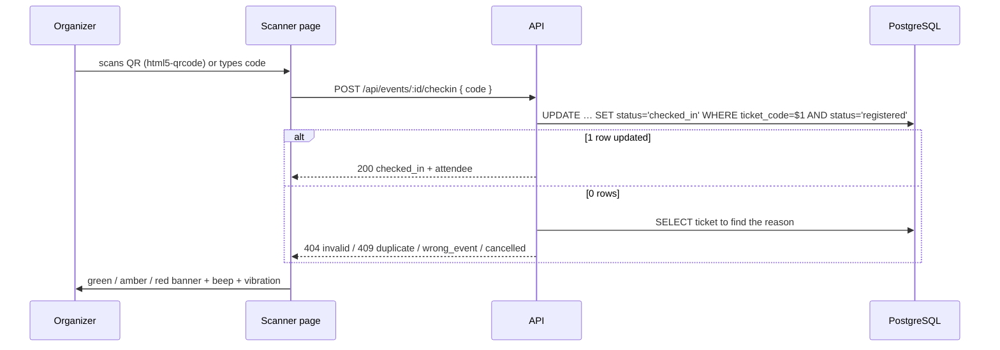
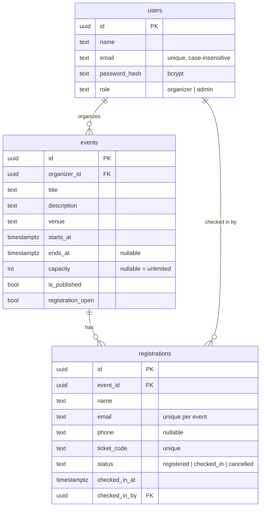

# Architecture

## System overview



The project is an npm workspace with two packages:

| Package | Path | Role |
| --- | --- | --- |
| `@eventpass/client` | `client/` | React 19 + Tailwind CSS 4 single-page app built with Vite. Mobile-first. |
| `@eventpass/server` | `server/` | Express 5 REST API, PostgreSQL via `pg`, QR generation, email delivery. |

In development the Vite dev-server proxies `/api/*` to the Express server, so the browser only ever talks to one origin. In production Express serves the built client from `client/dist` (`SERVE_CLIENT=true`), so a single process (or container) runs the whole platform.

## Key flows

### Registration → QR ticket

```mermaid
sequenceDiagram
  participant U as Attendee
  participant C as React app
  participant S as API
  participant D as PostgreSQL
  participant M as SMTP
  U->>C: fills name / email / phone
  C->>S: POST /api/events/:id/register
  S->>D: BEGIN; SELECT event FOR UPDATE
  S->>D: count seats, check duplicate email
  S->>D: INSERT registration (random ticket code); COMMIT
  S-->>C: 201 { ticket, qrDataUrl }
  S-)M: email with QR attachment (async)
  C->>U: /ticket/CODE page with QR
```

- The event row is locked (`SELECT … FOR UPDATE`) and the seat count is taken **after** the lock in a fresh statement, so two people cannot both take the last seat.
- Ticket codes look like `K7MQ2-9XHBT`: 10 characters from a 32-letter alphabet without `0/O/1/I`, giving 50 bits of entropy. The QR image encodes the public ticket URL (`CLIENT_URL/ticket/CODE`), so a phone camera opens the ticket while the organizer's scanner extracts the code.
- Email is fire-and-forget: a failing SMTP server never fails a registration; the ticket is always visible on screen and can be re-sent.

### Check-in



The check-in is a single conditional `UPDATE`, so concurrent scans of the same ticket can only succeed once – verified by the test-suite.

### Live dashboard

The dashboard polls `GET /api/events/:id/stats` every 5 seconds (a deliberate choice over WebSockets: it works through any proxy or hosting platform, needs no extra infrastructure, and the cost of one small query per organizer every 5 s is negligible). The scanner page polls every 10 s and also updates its counters optimistically after each scan.

## Data model



Schema lives in `server/src/db/migrations/*.sql`; `server/src/db/migrate.js` applies new files in order and records them in `schema_migrations`. The server runs pending migrations on start-up (`AUTO_MIGRATE=true`).

## API reference

All endpoints are under `/api`. Request and response bodies are JSON. Organizer endpoints require `Authorization: Bearer <token>`.

### Errors

```json
{ "error": "Please check the highlighted fields", "code": "VALIDATION", "details": [{ "path": "email", "message": "Enter a valid email address" }] }
```

| Status | Meaning |
| --- | --- |
| 400 | Validation failed (`VALIDATION`), malformed id (`BAD_ID`) |
| 401 | Missing / invalid token (`UNAUTHENTICATED`), bad login (`BAD_CREDENTIALS`) |
| 403 | Not the event's organizer (`NOT_OWNER`), bad sign-up code |
| 404 | Unknown event / ticket / registration |
| 409 | Conflicts: `ALREADY_REGISTERED`, `EVENT_FULL`, `REGISTRATION_CLOSED`, `EVENT_ENDED`, `EMAIL_TAKEN`, or a check-in result |
| 429 | Rate limited |

### Public

| Method | Path | Description |
| --- | --- | --- |
| GET | `/health` | Liveness check |
| GET | `/events` | Published events with registration counts |
| GET | `/events/:id` | One published event (organizers also see their drafts) |
| POST | `/events/:id/register` | `{ name, email, phone? }` → `201 { ticket, qrDataUrl }` |
| POST | `/events/:id/resend-ticket` | `{ email }` → always `200` (no attendee enumeration) |
| GET | `/tickets/:code` | Ticket details (masked email) + QR. Accepts code, code without dash, or ticket URL |

### Auth

| Method | Path | Description |
| --- | --- | --- |
| POST | `/auth/signup` | `{ name, email, password, signupCode? }` → `201 { token, user }` |
| POST | `/auth/login` | `{ email, password }` → `{ token, user }` |
| GET | `/auth/me` | Current organizer |

### Organizer

| Method | Path | Description |
| --- | --- | --- |
| GET | `/events/mine` | My events with `registrationCount` / `checkedInCount` |
| POST | `/events` | Create event (`title, description?, venue?, startsAt, endsAt?, capacity?, isPublished?, registrationOpen?`) |
| PATCH | `/events/:id` | Partial update |
| DELETE | `/events/:id` | Delete event and its registrations |
| GET | `/events/:id/stats` | Totals, 15-minute check-in timeline, registrations per day, 10 most recent check-ins |
| GET | `/events/:id/registrations?search=&status=&limit=&offset=` | Paginated list |
| GET | `/events/:id/registrations/export` | CSV download |
| DELETE | `/events/:id/registrations/:registrationId` | Cancel a registration (frees the seat) |
| POST | `/events/:id/checkin` | `{ code }` → `200 { result: "checked_in", attendee }`, `409 { result: "duplicate" \| "wrong_event" \| "cancelled" }`, `404 { result: "invalid" }` |
| DELETE | `/events/:id/checkin/:code` | Undo a check-in |

## Security notes

- **Passwords** are hashed with bcrypt (cost 10). **Sessions** are stateless JWTs (7 days by default) stored in `localStorage`; the API never sets cookies, so CSRF does not apply.
- **SQL injection**: every query is parameterised through `pg`.
- **Headers**: `helmet` with an explicit Content-Security-Policy (`script-src 'self'`, images from `data:` for QR codes, camera streams via `blob:`).
- **Rate limits**: 600 requests / 15 min per IP on the API, 30 on login/sign-up, 20 on registration & re-send.
- **Privacy**: the public ticket page masks the attendee's email; `resend-ticket` responds identically whether or not the address exists.
- **Authorization**: every organizer route checks that the event belongs to the logged-in user (`loadOwnedEvent`).
- **Exports**: CSV cells starting with `= + - @` are prefixed with `'` to block spreadsheet formula injection.
- **Optional sign-up gate**: set `ORGANIZER_SIGNUP_CODE` so only people who know the code can create organizer accounts.

## Testing

- `server/test/*.test.js` – 31 integration tests (Vitest + Supertest) against a real PostgreSQL database: authentication, event CRUD and permissions, registration rules (duplicates, capacity under concurrency, closed/ended events), ticket lookup, email delivery, check-in outcomes (including concurrent scans), undo, statistics and CSV export.
- `client/src/**/*.test.{js,jsx}` – unit tests for the ticket-code parser and a rendering test of the home page with a mocked API.
- `.github/workflows/ci.yml` runs lint, both test-suites and the production build on every pull request.

## Possible extensions

- WebSocket / Server-Sent Events push instead of polling for very large events.
- Multiple staff accounts per event (currently one organizer owns an event).
- Paid tickets, waiting lists and attendee self-cancellation.
- Service worker for offline ticket display.
